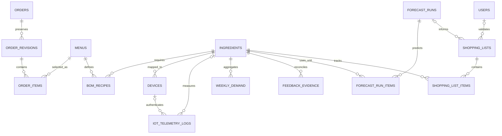

# Backend SiKembang · Skema dan provenance data

Backend Sprint 6A adalah satu aplikasi FastAPI pada paket `sikembang_backend`. SQLite menyimpan data operasional dan fixture secara persisten. Koneksi SQLAlchemy menyalakan foreign keys dan menggunakan transaksi eksplisit. Timestamp tersedia sebagai instant berzona, disimpan dalam UTC. Tanggal event dan Senin minggu target dibaca menurut kalender `Asia/Jakarta`.

## ERD

| Tabel | Kunci dan semantik |
|---|---|
| `orders`, `order_revisions`, `order_items` | Identitas order tetap. PK revisi `(order_id, version)`, PK item `(order_id, version, menu_id)`. Item menunjuk revisi yang tepat. Status, tanggal acara, waktu efektif dan waktu tersedia melekat pada revisi. |
| `ingredients`, `menus`, `bom_recipes` | ID dan satuan dasar dari katalog. Resep per porsi diidentifikasi oleh `(menu_id, ingredient_id, bom_version)`. Order item menyimpan versi BOM. |
| `users`, `devices`, `iot_telemetry_logs` | Username dan sensor ID unik, kredensial disimpan dalam bentuk hash. Log memuat paket mentah, keputusan dan waktu terima. Paket ditolak dapat mempertahankan ID yang diklaim. Paket diterima menyimpan mapping sensor serta nilai/satuan kanonis. |
| `weekly_demand`, `feedback_evidence` | Agregat kebutuhan pada `(week_start, ingredient_id)` dengan kelengkapan, satuan, dan waktu tersedia. Kunci feedback menambahkan waktu approval untuk memilih snapshot historis yang tepat. |
| `forecast_runs`, `forecast_run_items` | Satu run berisi waktu cutoff/publikasi, versi model, snapshot, provenance dan audit feedback. Item menyimpan BOM terkonfirmasi pada origin, prediksi tambahan dan koreksi terpakai. Header dan item disimpan sebagai satu transaksi. |
| `shopping_lists`, `shopping_list_items` | State D2, referensi run opsional, warning, metadata review/sent, komponen kalkulasi dan kuantitas/catatan PPIC. Periode unik karena ketiga state D2 yang tersedia tetap mencadangkan daftar. |

## Provenance dan kompatibilitas

| Data | Sumber dan batas pemakaian |
|---|---|
| Katalog dan BOM | Fixture `synthetic-bom-v1` milik Sprint 1–5. ID form `MNU-N01/A01/S01` adalah hidangan. `MNU-W01/K02` adalah paket tersendiri. Resep dipisahkan agar dua representasi tidak otomatis menjadi alias. |
| Bahan | Beras `ING-001` dan ayam `ING-003` dalam kg, telur `ING-007` dalam butir, santan `ING-009` dan minyak goreng `ING-012` dalam liter. Satuan dan takaran BOM cocok dengan artefak XGBoost. |
| Demo order dan stok | Dua booking buatan untuk minggu yang dipilih, dengan waktu konfirmasi tetap. Stok awal dan safety stock mengikuti fixture MSW. Stok seed memiliki `last_iot_sync=NULL` karena belum ada paket sensor yang menyinkronkannya. |
| Histori dalam rentang arsip | Ambil agregat demand dan rekonsiliasi bertanda sintetis dari bundle Sprint 2 setelah memeriksa checksum dan versi katalog. Hanya baris tersedia pada cutoff yang dimasukkan. |
| Histori di luar arsip | Jalankan generator order/BOM yang sama per minggu lampau dengan stream seed tetap. Simpan hanya agregat empat minggu tertutup serta waktu ketersediaannya. Kebijakan koreksi netral berlaku bila histori feedback belum ada. |
| Akun dan sensor demo | Marketing, PPIC dan PFA mendapat password sendiri dari environment. Sensor gudang `SNS-GDG-01` mengikat beras dan sensor kulkas `SNS-KLK-01` mengikat ayam. Kunci masing-masing berasal dari environment. Registry berlabel sintetis belum membuktikan koneksi fisik. |

Seed bersifat menambah baris yang belum ada dalam satu transaksi. Pengulangan periode yang sama mempertahankan revisi order, stock, hash akun, dan binding yang sudah tersimpan. Katalog yang tidak kompatibel gagal secara eksplisit. Data operasional, riwayat telemetry fisik, serta bukti resep resmi memerlukan sumber terverifikasi sebelum dipakai.
